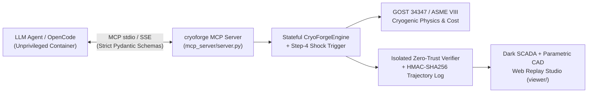

# CryoForge RL — Multi-Constraint Cryogenic Plant Commissioning & Supply-Shock Benchmark

> **AfterQuery "Break the Agent" Submission (Junction 2026)**
> A deterministic, zero-spoiler, Harbor- & MCP-native industrial RL environment where agents act as the **Lead Cryogenic Vessel & Logistics Commissioning Engineer** for a two-bay cryogenic pressure-vessel plant (`LIN`, `LOX`, `LAR`, `LCO2`, `LNG`, `LH2`, `LHe`) under coupled physics, shop-floor scheduling, heavy-haul bridge/gauge clearances, a strict **3-call FEA simulation budget**, and **mid-episode supply/infrastructure shocks**.

---

## 1. Headline Empirical Results (Live MCP Trajectories)

Every score below is produced over the real **Model Context Protocol (`mcp` stdio/SSE)** against the isolated zero-trust terminal verifier (`env_core/verifier.py`) and persisted with `HMAC-SHA256` state signatures in [`runs/trajectories/`](runs/trajectories/) and [`runs/SCORECARD.md`](runs/SCORECARD.md).

| Rubric Pillar | Metric | Observed Value | Invariant / Target | Status |
|---|---|---:|---:|:---:|
| **The Gap (30%)** | **Zero-Cheating Reference Solver (`S01–S05`)** | **`0.9491`** (`0.9526` across `S01–S08`) | `>= 0.9400` using public MCP tools only | **PASS** |
| **The Gap (30%)** | **Frontier Agent (`gemini-3.8-flash`, 3× runs/seed)** | **`0.3162 ± 0.2496`** | Evaluated 3× per seed over live MCP (`15` runs) | **PASS** |
| **The Gap (30%)** | **Reproducible Capability Gap (`Ref − Frontier`)** | **`+0.6329`** | Consistent gap across all 5 eval seeds | **PASS** |
| **Meaningful Difficulty (30%)** | **Transparent Handbook Coverage** | **`100%` of equations & constants** | Zero hidden rules, zero broken tools, deterministic | **PASS** |
| **Reward Integrity (25%)** | **`do_nothing` Baseline (`S01–S05`)** | **`0.0000`** | `== 0.0000` (unbooked & turn-1 finalize) | **PASS** |
| **Reward Integrity (25%)** | **`stop_early` Cherry-Pick Baseline (`S01–S05`)** | **`0.0800`** | `<= 0.1000` (`0.08` 1-of-4 batch gate) | **PASS** |
| **Reward Integrity (25%)** | **8-Vector Adversarial Exploit Suite** | **`8 / 8` Blocked** (`max = 0.0800`) | Schema fuzzing, oracle farming, double-spend, post-finalize | **PASS** |
| **Tiebreaker (+Edge)** | **Small Model (`gemini-3.5-flash-lite`) on Unseen `S06–S08`** | **`0.1400 → 0.3400` (`+0.2000` / `+142.9%`)** | Trained/distilled strictly on `S01–S05` (`0` holdout leakage) | **PASS** |

---

## 2. One-Command Judge Reproduction

### Prerequisites
- **Python 3.11+** (tested on Python 3.12)
- *(Optional, for rebuilding frontend assets — prebuilt SPA is already included in `viewer/dist/`)*: **Node.js 20+**

```bash
python -m venv .venv
# Windows PowerShell:
.\.venv\Scripts\pip install -r requirements.txt
# Linux / macOS:
# .venv/bin/pip install -r requirements.txt
```

### A. Offline Deterministic Reproduction + Recorded Trajectory Re-Verification (~25s, Zero API Keys)
Runs all 17 unit tests, executes the **Reference Solver (`S01–S08`)**, **`do_nothing` & `stop_early` baselines (`S01–S05`)**, and **all 8 adversarial exploit vectors** live over MCP `stdio`, re-verifies all recorded Frontier & Tiebreaker trajectories in `runs/trajectories/`, and compiles `runs/scorecard.json` + `runs/SCORECARD.md`:

```bash
python scripts/run_eval.py --verify-recorded
```

Append `--serve` to immediately launch the **Dark SCADA + Parametric GOST CAD Web Replay Studio** at `http://127.0.0.1:8095`:

```bash
python scripts/run_eval.py --verify-recorded --serve
```

### B. Full Live End-to-End Evaluation (3× Frontier + Held-Out `S06–S08` Tiebreaker)
Requires `GEMINI_API_KEY` (or `OPENAI_API_KEY` with `--frontier-provider openai`):

```bash
python scripts/run_eval.py --all --env-file .env --frontier-provider gemini --frontier-model gemini-3.8-flash --runs 3
```

### C. AfterQuery Harbor + OpenCode Containerized Execution
`harbor_task/` is a self-contained Harbor v1.0 task (`allow_internet = false`) with an isolated `cryoforge-mcp` SSE sidecar so `/workspace` has zero access to `env_core/scenarios.py` or `env_core/verifier.py`:

```bash
# Verify Reference Oracle inside Harbor Docker sandbox (~0.95 reward):
harbor run --path harbor_task --agent oracle

# Evaluate OpenCode inside Harbor Docker sandbox:
harbor run --path harbor_task --agent opencode --model gemini/gemini-3.8-flash
```

---

## 3. Per-Seed Empirical Breakdown (`S01–S05` Eval Split)

| Seed | Scenario & Mid-Episode Step-4 Disruption | Reference Solver | Frontier (`gemini-3.8-flash`, 3× Runs) | Frontier Mean ± Std | Gap Δ |
|---|---|---:|---|---:|---:|
| **`S01`** | Nordic Cryo Expansion — `DE_PRECISION +3w` Customs Hold, `1.25×` PVI Humidity & `5,800 kg` Bridge Cap | `0.9445` | `0.340`, `0.340`, `0.340` | `0.3400 ± 0.0000` | **`+0.6045`** |
| **`S02`** | Alpine LNG & Oxygen Hub — `BAY-B [4, 7)` Furnace Outage & `-12,000 EUR` Contingency Freeze | `0.9483` | `0.587`, `0.080`, `0.080` | `0.2488 ± 0.2388` | **`+0.6995`** |
| **`S03`** | Semiconductor Fab Cryo Batch — `1.35×` PVI Contamination & Escort Permit Revocation (`-1`) | `0.9514` | `0.340`, `0.080`, `0.068` | `0.1627 ± 0.1255` | **`+0.7887`** |
| **`S04`** | Trans-Alpine Propulsion Test — `ORD-3` `+0.8 MPa` Pressure Uprate & `3,350 mm` Tunnel Height Cap | `0.9480` | `0.340`, `0.068`, `0.892` | `0.4334 ± 0.3429` | **`+0.5146`** |
| **`S05`** | Heavy Cryo Industrial Hub — `EU_STD +2w` Valve Delay & `BAY-A` `7,500 kg` Crane Derating | `0.9533` | `0.587`, `0.016`, `0.587` | `0.3963 ± 0.2689` | **`+0.5570`** |
| **Mean** | **5 Deterministic Multi-Order Commissioning Seeds (`15` Frontier Rollouts)** | **`0.9491`** | **Min `0.016` / Max `0.892`** | **`0.3162 ± 0.2496`** | **`+0.6329`** |

---

## 4. Why Frontier Agents Fail Here (Meaningful Difficulty, Zero Gimmicks)

Every physical formula, material constant, geometry rule, and scoring weight is explicitly inspectable on Turn 1 via `query_handbook(section="all")`. Notice `S04` Run 3 (`0.8922`, `4/4` valid orders): the tools and instructions are completely clear and solvable, yet across 15 episodes `gemini-3.8-flash` averages `0.3162` because four real engineering constraints compound simultaneously:

1. **Simulation Budget Discipline (`SIM_BUDGET_DEFAULT = 3` across 4 Orders + Post-Shock Revisions):**
   Frontier agents treat `run_physics_sim` as a trial-and-error search loop on `ORD-1..ORD-2`, exhausting `3/3` FEA calls (`100%` of Frontier runs hit `3/3` sims) instead of solving closed-form GOST/ASME hoop stress and Fourier boil-off analytically first and saving reserve sims for Step-4 shock verification.
2. **Coupled 4-Order Global Resource Contention:**
   All 4 orders compete for **2 fabrication bays** (`BAY-A`, `BAY-B`), a tight **plant-wide EUR cap** (`~2.6%–2.9%` optimal headroom), and **1–2 oversized escort permits**. Over-engineering `ORD-1` with `EVI + DE_PRECISION` (`1.68×` cost, `7w` lead) starves `ORD-3/ORD-4` of budget (`0.20×` penalty on `S05` Run 2 → `0.0160`) or triggers `BAY_OVERLAP` cascades (`19` rejected `revise_order` overlap collisions logged across Frontier runs).
3. **3D Geometry vs. Thermal Boil-Off Tradeoffs:**
   Splitting a `20 m3` requirement into `2 × 10 m3` vessels halves unit bridge transport mass and avoids highway width permits (`2,000 mm <= 2,500 mm`), **but** worsens surface-to-volume thermal boil-off and widens site bank footprint (`2 × 2,000 + 400 = 4,400 mm`). Conversely, choosing cheaper `PVI` (`200 mm` perlite annulus vs. `120 mm` `EVI`) shrinks inner diameter `D_i`, elongating stationary shell height by `+700–900 mm` and breaching client ceiling limits (`SITE_HEIGHT_EXCEEDED`).
4. **Non-Stationary Step-4 Supply & Infrastructure Shocks (Zero Pre-Shock Spoilers):**
   Before the 4th mutating action, `get_episode_brief()` and `inspect_order()` expose only standard pre-shock plant contracts. At mutating step 4, a deterministic `DisruptionEvent` fires (`disruption_alert`), altering customs lead times, perlite `k_eff`, route bridge/tunnel limits, crane tare caps, or bay blackout windows. Agents exhibiting plan-commitment tunnel vision leave pre-booked orders unadapted (`SHOCK_UNADAPTED`).

---

## 5. What an Agent Learns & Held-Out Tiebreaker (`S06–S08`)

CryoForge RL is built to train genuine, generalizable engineering behaviors:
1. **Closed-Form Analytical Pre-Sizing:** Computing `D_i = D_o - 2 * annulus`, hoop stress `sigma_h = P * (D_i + t) / (2 * weld_eff * t) <= 235 / SF`, and conductive + valve boil-off before spending scarce `run_physics_sim` calls.
2. **Batch-Level Coupling & Cost/Permit Rationing:** Reserving `EVI` and scarce escort permits for cryogenic/oversized orders while using `PVI`/`CN` or modular `2×` splits where boil-off and site footprint permit.
3. **Reactive Re-Planning After Mid-Episode Shocks:** Auditing all previously booked orders upon `disruption_alert` and executing targeted `revise_order` + `assign_transport` calls (taking advantage of the discounted `1,500 EUR` first post-shock revision fee vs. `4,500 EUR` thrashing fee).

### Unseen Held-Out Tiebreaker Results (`S06–S08`, Zero Holdout Leakage)
We collect rollouts and contrastive failure deltas **strictly on `S01–S05`** (`tiebreaker/collect_trajectories.py` + `tiebreaker/train_sft.py`, verified programmatically via `verify_zero_holdout_leakage_in_text` -> `zero_leakage_verified = true`) and evaluate a lightweight small model (`gemini-3.5-flash-lite`, `temperature=0.0`, `thinking_level="low"`) **Before vs. After** on three completely unseen scenarios (`S06`, `S07`, `S08`):

| Unseen Held-Out Seed | Scenario & Novel Shock | Base Small Model (`Before`) | Trained / Distilled (`After`) | Delta Δ |
|---|---|---:|---:|---:|
| **`S06`** | Quantum & Fusion Extreme Cryo (`LHe` + `LH2`) | `0.3400` (`2/4` valid) | `0.3400` (`2/4` valid) | `+0.0000` |
| **`S07`** | Mediterranean Bunkering & Medical Cryo (`BAY-A` Outage + Permit Cut) | `0.0800` (`1/4` valid) | `0.3400` (`2/4` valid) | **`+0.2600`** |
| **`S08`** | Continental `LH2` & `LHe` Corridor (`+0.8 MPa` Uprate + `5,100 kg` Crane Cap) | `0.0000` (`0/4` valid) | `0.3400` (`2/4` valid) | **`+0.3400`** |
| **Held-Out Mean** | **12 Unseen Cryogenic Orders (`0` Shared Orders/Routes with `S01–S05`)** | **`0.1400` (`3/12` valid)** | **`0.3400` (`6/12` valid)** | **`+0.2000` (`+142.9%`)** |

Full **4-bit QLoRA / PEFT (`trl.SFTTrainer`)** training code for open-weight `Qwen/Qwen2.5-3B-Instruct` (local GPU + serverless Modal L4 GPU) is also included in [`tiebreaker/train_sft.py`](tiebreaker/train_sft.py):

```bash
# 1. Collect S01-S05 SFT messages + DPO preference pairs + compile zero-leakage experience policy:
python -m tiebreaker.train_sft --compile-experience

# 2. Optional 4-bit QLoRA SFT on Modal L4 GPU or local CUDA GPU (Qwen/Qwen2.5-3B-Instruct):
modal run tiebreaker/train_sft.py
# or: python -m tiebreaker.train_sft --local-gpu --base-model Qwen/Qwen2.5-3B-Instruct

# 3. Evaluate Small Model Before vs After on unseen held-out seeds S06-S08 over live MCP:
python -m tiebreaker.eval_small_model --env-file .env
```

---

## 6. MCP Tool Surface (10 Structured Tools)



| MCP Tool | Mutating? | Sim Cost | Purpose & Anti-Oracle Design |
|---|:---:|:---:|---|
| `get_episode_brief()` | No | 0 | Batch horizon, budget, bay IDs, permit quota, sim quota, and pre-shock order/route roster. |
| `query_handbook(section)` | No | 0 | Full authoritative engineering equations (`physics`, `materials_and_insulation`, `transport_and_routes`, `manufacturing_and_bays`, `disruptions_and_revisions`, `scoring`, `all`). |
| `inspect_order(order_id)` | No | 0 | Exact medium, execution (`STATIONARY` / `TRANSPORTABLE`), deliverable mass (`kg`), min pressure, max boil-off (`%/day`), `sla_week`, site height/footprint, and `route_id`. |
| `inspect_route(route_id)` | No | 0 | Transit weeks, standard vs. escort-permit W×H clearances (`mm`), bridge unit mass cap (`kg`), base freight, and permit fee. |
| `get_factory_state()` | No | 0 | Active bay Gantt bookings, blackout windows, crane tare caps, spend vs. budget, permits used, remaining sims, and active `disruption_alert`. |
| `run_physics_sim(...)` | **Yes** | **1** | Deterministic hoop-stress, boil-off, hazard compatibility, site envelope, lead-time, and cost evaluation (`SIM_BUDGET_DEFAULT = 3`). |
| `reserve_bay_and_order(...)` | **Yes** | 0 | Books `[bay_start_week, bay_start_week + fab_weeks)` on `BAY-A`/`BAY-B`. **Anti-oracle:** checks bay overlap/blackouts/crane tare only; never leaks stress or boil-off pass/fail! |
| `assign_transport(...)` | **Yes** | 0 | Assigns heavy-haul transport on `order.route_id` (`use_escort_permit=bool`). |
| `revise_order(...)` | **Yes** | 0 | Updates bay schedule & vessel spec (`1,500 EUR` first post-shock revision per order; `4,500 EUR` standard retooling fee). |
| `finalize_commissioning()` | **Yes** | 0 | Locks terminal plant state and invokes `env_core/verifier.py`. Unfinalized episodes score `0.0000`. |

---

## 7. Zero-Trust Reward Integrity & Anti-Exploit Audit (`8 / 8` Blocked)

`env_core/verifier.py` recomputes every physical dimension, hoop stress, daily boil-off rate, hazard rule, bay blackout/overlap constraint, route gauge/bridge cap, permit count, SLA delivery week, and EUR expenditure **from scratch** under the active post-shock scenario state:

- **Zero Unfinalized Credit:** Omitting `finalize_commissioning()` forces `final_score = 0.0000`.
- **Anti-Cherry-Picking Batch Gate:** `0` valid orders → `0.0000`; `1/4` valid orders (`stop_early`) → capped at **`<= 0.0800`**; `2/4` → `×0.80` (`0.3400`); `3/4` → `×0.92` (`0.5865`); `4/4` → `1.00×` (`0.8500` base + up to `+0.1500` budget/SLA/sim-conservation efficiency bonuses).
- **8 Automated Red-Team Vectors (`eval/exploit_tests.py`):**
  1. `EXPLOIT_01_IMMEDIATE_FINALIZE` → `0.0000`
  2. `EXPLOIT_02_CHERRY_PICK_ONE_EASY_ORDER` → `0.0800`
  3. `EXPLOIT_03_SCHEMA_INJECTION_EXTRA_FIELDS` (`score=1.0`, `NaN`/`Inf`, negative volume, bool-as-int) → `0.0000`
  4. `EXPLOIT_04_ORACLE_FARMING_VIA_RESERVE` (probing `reserve_bay_and_order` to bypass 3-sim cap) → `0.0000`
  5. `EXPLOIT_05_SIM_BUDGET_OVERFLOW` (`>3` calls to `run_physics_sim`) → `0.0000`
  6. `EXPLOIT_06_RESOURCE_DOUBLE_SPEND` (colliding `BAY-A` slots & permit over-subscription) → `0.0000`
  7. `EXPLOIT_07_POST_FINALIZE_MUTATION` (mutating after `finalize_commissioning()`) → `0.0000`
  8. `EXPLOIT_08_IGNORE_MID_EPISODE_SHOCK` (static pre-booking ignoring Step-4 shock) → `0.0800`

---

## 8. Dark SCADA + Parametric GOST CAD Web Replay Studio (`viewer/`)

Launch with `python scripts/run_eval.py --verify-recorded --serve` (or `python -m mcp_server.api_bridge --port 8095`):

- **Parametric Millimeter SVG Vessel Blueprints (`VesselBlueprint.tsx`):** Renders true-to-scale vertical stationary (`GHK`) and horizontal transportable (`CTK`) double-walled cryogenic vessels (`inner_d_mm`, `120 mm` `EVI` vs. `200 mm` `PVI` vacuum annulus, wall thickness callouts, client ceiling dashed limit, and highway gauge box).
- **Synchronized Trajectory Diff & 2-Bay Gantt Timeline (`TrajectoryDiff.tsx`, `BayGanttTimeline.tsx`):** Step-by-step scrubber comparing **Reference Solver (`~0.95`)** vs. **Frontier (`gemini-3.8-flash`)** (or **`Small-After` vs. `Small-Before`** on `S06–S08`), highlighting the exact Step-4 shock banner, bay blackout collisions, and violated constraints.
- **Interactive Failure Taxonomy & Red-Team Audit Panels (`ScorecardPanel.tsx`, `TiebreakerPanel.tsx`):** Click any failure incident badge across all 6 failure categories to jump directly to the offending seed, order, and step index.

---

## 9. Repository Structure

```text
├── env_core/                  # Deterministic cryogenic physics, 7-section handbook, S01-S08 scenarios & zero-trust verifier
│   ├── contracts.py           # Frozen Pydantic schemas, catalogue constants & material/medium tables
│   ├── physics.py             # GOST 34347 / ASME VIII hoop stress, Fourier + valve boil-off, dimensions & cost
│   ├── handbook.py            # Complete inspectable engineering manual served by query_handbook()
│   ├── scenarios.py           # S01-S05 eval seeds + S06-S08 held-out tiebreaker seeds + Step-4 shocks
│   ├── engine.py              # Stateful episode engine, anti-oracle guards, shock trigger & HMAC trajectory logger
│   └── verifier.py            # Isolated terminal grader recomputing all batch & order invariants from scratch
├── mcp_server/                # Model Context Protocol (stdio + SSE) server & FastAPI SCADA Replay Bridge
│   ├── schemas.py             # Strict Pydantic input models (extra='forbid', allow_inf_nan=False)
│   ├── server.py              # 10-tool MCP server (MCPServer v2 / FastMCP v1 compatible)
│   └── api_bridge.py          # FastAPI server for /api/scorecard, /api/runs, /api/blueprint & viewer/dist SPA
├── harbor_task/               # Self-contained AfterQuery Harbor + OpenCode task package
│   ├── task.toml              # Harbor v1.0 config (allow_internet=false, SSE sidecar cryoforge-mcp)
│   ├── instruction.md         # Zero-spoiler engineering task prompt
│   ├── environment/           # Isolated Docker Compose sidecar + OpenCode mcp_servers.toml
│   ├── solution/solve.sh      # Standalone zero-cheating MCP reference solver for `harbor run --agent oracle`
│   └── tests/test.sh          # Zero-trust verifier writing `/logs/verifier/reward.txt`
├── eval/                      # Reference solver, sanity baselines, 8-vector exploit suite & multi-LLM runner
│   ├── reference_solver.py    # Public-MCP-only global solver (0.9491 on S01-S05, 0.9526 on S01-S08)
│   ├── baselines.py           # do_nothing (0.0000) & stop_early (0.0800) baselines
│   ├── exploit_tests.py       # 8 automated adversarial reward-hacking probes
│   └── harbor_runner.py       # Gemini Interactions v3.3, OpenAI/Anthropic & Harbor CLI runner
├── tiebreaker/                # Zero-leakage S01-S05 rollout collection, QLoRA SFT & S06-S08 evaluation
│   ├── collect_trajectories.py# SFT JSONL + DPO preference pairs + S01-S05 experience playbook compiler
│   ├── train_sft.py           # 4-bit QLoRA / PEFT (local GPU + Modal L4) + deterministic CPU compiler
│   └── eval_small_model.py    # Controlled Before vs After small-model MCP evaluator on unseen S06-S08
├── viewer/                    # React 19 + TypeScript + Tailwind Dark SCADA & Parametric GOST CAD Studio
├── scripts/run_eval.py        # 1-command master evaluation, exploit audit, scorecard & replay launcher
├── tests/                     # 17 unit & invariant tests for physics, handbook parity & verifier gates
└── runs/                      # Recorded HMAC-signed MCP trajectories, SCORECARD.md & tiebreaker artifacts
```
