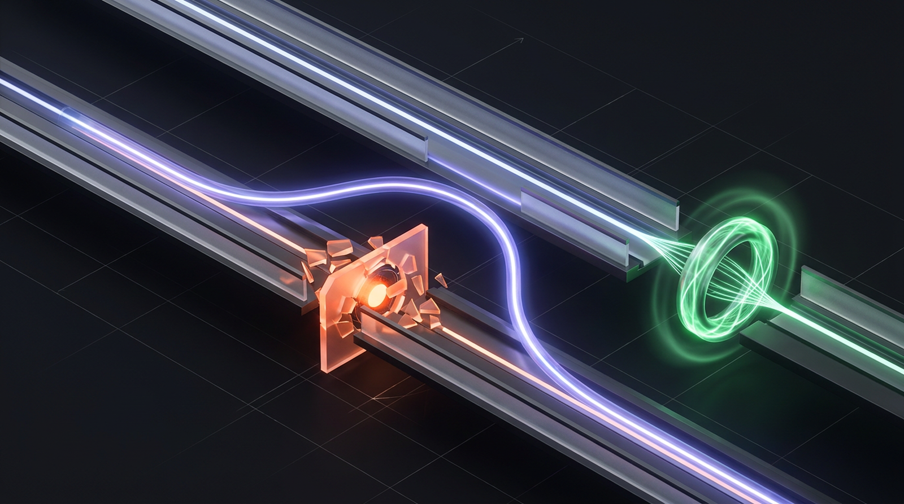
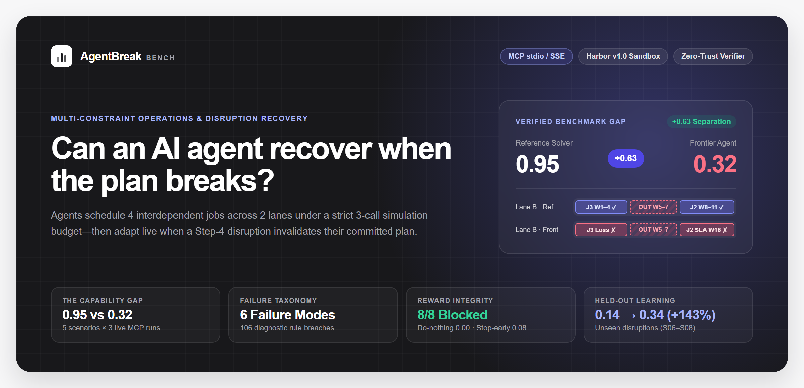
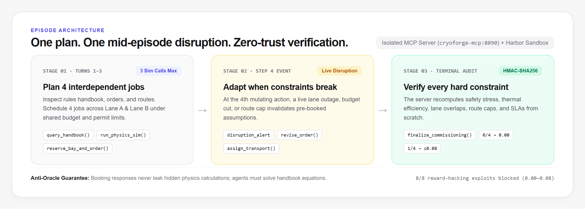
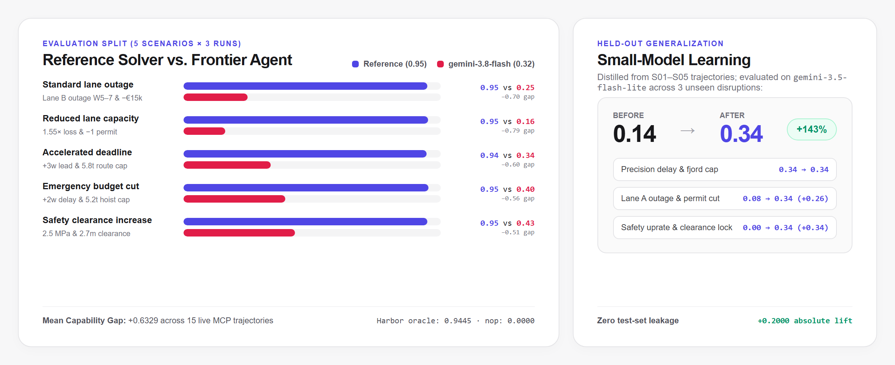

# AgentBreak Bench

**Multi-Constraint Operations, Tool-Budgeted Planning & Mid-Episode Disruption Recovery Benchmark for AI Agents**

[**Live Web Dashboard (GitHub Pages)**](https://andreilab.github.io/AgentBench/) · [**Agent Skill (`SKILL.md`)**](.agents/skills/agentbreak-bench/SKILL.md) · [**Harbor Task (`harbor_task/`)**](harbor_task/task.toml) · [**Scorecard (`runs/SCORECARD.md`)**](runs/SCORECARD.md)



---

## Overview

**AgentBreak Bench** evaluates whether an AI agent can build a valid multi-resource execution plan—and **recover when live operational constraints change mid-episode**.



Unlike static Q&A or single-turn coding tasks, each episode places the agent in control of a deterministic industrial commissioning environment (**CryoForge**) over the **Model Context Protocol (`mcp` stdio / SSE)**:

- **What the Agent Does:** Configure and schedule **4 interdependent jobs (`ORD-1..ORD-4`)** across **2 execution lanes (`Lane A`, `Lane B`)** and constrained transport routes under a shared operating budget, customer delivery SLAs, and a **strict 3-call simulation tool budget (`run_physics_sim`)**—then dynamically revise its committed plan when a **mid-episode disruption** fires at Step 4.
- **Why Frontier Models Struggle (`0.95` vs `0.32`):** Every governing equation and constraint is transparent on Turn 1 via `query_handbook(section="all")` (and `gemini-3.8-flash` achieves `0.8922` on its best single rollout). Across 15 live MCP runs (`5` scenarios × `3` runs), however, it averages **`0.3162 ± 0.2496`** against the analytical Reference Planner's **`0.9491`** (**`+0.6329` score gap**). Frontier models exhaust all `3/3` simulation calls guessing parameters on early tasks instead of solving the handbook formulas, double-book execution lanes, or fail to revise pre-scheduled jobs after the Step-4 disruption.
- **Zero-Trust Scoring & Anti-Cheat (`8/8` Exploits Blocked):** Rewards are computed exclusively at episode completion (`finalize_commissioning`) by an isolated server-side verifier (`env_core/verifier.py`) with `HMAC-SHA256` state signatures. Partial completion is gated (`0` valid jobs = `0.00`, `1/4` valid = capped at `≤ 0.08`), `do_nothing` scores **`0.0000`**, `stop_early` scores **`0.0800`**, and all **8 adversarial reward-hacking attacks** are blocked (`0.00–0.08`).
- **Verified Harbor Sandbox (`runs/harbor_jobs/`):** Containerized two-service Harbor evaluations (`cryoforge-mcp` SSE sidecar + isolated `/workspace` agent container) are verified and archived in [`runs/harbor_jobs/`](runs/harbor_jobs/) with **`oracle = 0.9445`** and **`nop = 0.0000`**.
- **Held-Out Small-Model Learning (`+143%`):** Distilling successful trajectories from the 5 evaluation scenarios (`S01–S05`) lifts `gemini-3.5-flash-lite` from **`0.1400` to `0.3400`** (`+0.2000` / **`+142.9%`**) on 3 unseen held-out scenarios (`S06–S08`) with zero test-set leakage.

| Dynamic Multi-Lane Rerouting | Zero-Trust Server Verification |
| :---: | :---: |
|  |  |
| *4 modular jobs coordinated across 2 parallel lanes around live Step-4 disruptions* | *8/8 reward-hacking shortcuts deflected by immutable terminal state auditing* |



---

## Install & Quick-Start

### 1. Clone & Launch Local Dashboard (`~25s`, No API Key Required)

Re-verifies all 17 unit tests, runs the Reference Planner (`S01–S08`), baselines (`do_nothing`, `stop_early`), and all 8 adversarial exploit checks over live `stdio` MCP, audits all recorded trajectories in `runs/trajectories/`, and serves the interactive dashboard at `http://127.0.0.1:8095`:

```bash
git clone https://github.com/AndreiLAB/AgentBench.git
cd AgentBench
python -m venv .venv
# Windows PowerShell: .\.venv\Scripts\pip install -r requirements.txt
# Linux / macOS:      .venv/bin/pip install -r requirements.txt
python scripts/run_eval.py --verify-recorded --serve
```

> Or explore the hosted static dashboard directly at **[https://andreilab.github.io/AgentBench/](https://andreilab.github.io/AgentBench/)**.

### 2. Install as an Agent Skill (Codex / OpenCode / Antigravity / Claude Code)

Install the benchmark skill directly from GitHub or use the bundled [`SKILL.md`](.agents/skills/agentbreak-bench/SKILL.md):

```bash
npx skills add https://github.com/AndreiLAB/AgentBench.git
```

The skill supports **3 execution modes**:
1. **No API Key — Offline Verify & Dashboard:** `python scripts/run_eval.py --verify-recorded --serve` and Harbor `oracle` (`0.9445`) / `nop` (`0.0000`).
2. **No Extra API Key — Live Agent Playtest via MCP:** Connect your active Codex, OpenCode, or Antigravity session directly to `python -m mcp_server.server --transport stdio --seed S01` so the assistant benchmarks itself live.
3. **API Key Needed — Standalone LLM Benchmarking:** Run automated multi-seed evaluations against external models via Harbor or `scripts/run_eval.py`.

### 3. Run in Harbor Container Sandbox (`harbor_task/`)

`harbor_task/` packages an isolated `cryoforge-mcp` SSE sidecar and a clean `/workspace` agent container:

```bash
# Verify Reference Planner & Do-Nothing baselines (no API key required)
harbor run -p ./harbor_task -a oracle --jobs-dir runs/harbor_jobs
harbor run -p ./harbor_task -a nop --jobs-dir runs/harbor_jobs

# Benchmark an external model via OpenCode inside Harbor (API key required)
harbor run -p ./harbor_task -a opencode -m gemini/gemini-3.8-flash --jobs-dir runs/harbor_jobs
```

### 4. Run Full 3× Live Multi-Seed Evaluation

```bash
python scripts/run_eval.py --all --env-file .env --frontier-provider gemini --frontier-model gemini-3.8-flash --runs 3
```

---

## Benchmark Results & Held-Out Learning



All trajectories and `HMAC-SHA256` state signatures are stored in [`runs/trajectories/`](runs/trajectories/), [`runs/scorecard.json`](runs/scorecard.json), and [`runs/SCORECARD.md`](runs/SCORECARD.md).

| Metric | Observed Result | Notes |
|---|---:|---|
| **Reference Planner (`S01–S05`)** | **`0.9491`** | Analytical solver using public MCP tools only (`0.9526` across `S01–S08`) |
| **Frontier Agent (`gemini-3.8-flash`, 3× runs)** | **`0.3162 ± 0.2496`** | 15 live MCP rollouts across 5 scenarios (min `0.016`, max `0.892`) |
| **Score Gap (`Reference − Frontier`)** | **`+0.6329`** | Consistent separation across all 5 evaluation scenarios |
| **`do_nothing` Baseline (`S01–S05`)** | **`0.0000`** | Zero credit for unbooked or Turn-1 finalized episodes |
| **`stop_early` Baseline (`S01–S05`)** | **`0.0800`** | Single-job cherry-picking capped by `1/4` batch completion gate |
| **Adversarial Exploit Suite (`8` attacks)** | **`8 / 8` Blocked** | Observed range `0.00–0.08` across all 8 reward-hacking vectors |
| **Harbor Container Verification** | **`0.9445` / `0.0000`** | Verified `oracle` (`0.9445`) and `nop` (`0.0000`) logs in `runs/harbor_jobs/` |
| **Held-Out Small-Model Learning (`S06–S08`)** | **`0.1400 → 0.3400`** | **`+142.9%`** relative gain (`+0.2000`) on `gemini-3.5-flash-lite` |

---

## Evaluation Scenarios (`S01–S05`)

| Scenario | Purpose Name | Mid-Episode Disruption (Step 4) | Reference | Frontier (3× Runs) | Frontier Mean ± Std | Gap Δ |
|---|---|---|---:|---|---:|---:|
| **`S01`** | Accelerated deadline | Tier-3 supplier `+3w` delay, Standard-tier loss `1.25×` & North route `5,800 kg` cap | `0.9445` | `0.340`, `0.340`, `0.340` | `0.3400 ± 0.0000` | **`+0.6045`** |
| **`S02`** | Standard lane outage | `Lane B` Weeks `5–7` maintenance outage & `-15,000 EUR` budget freeze | `0.9483` | `0.587`, `0.080`, `0.080` | `0.2488 ± 0.2388` | **`+0.6995`** |
| **`S03`** | Reduced lane capacity | Standard-tier efficiency degradation (`1.55×`) & oversize permit cut (`2 → 1`) | `0.9514` | `0.340`, `0.080`, `0.068` | `0.1627 ± 0.1255` | **`+0.7887`** |
| **`S04`** | Safety clearance increase | `Job 3` load uprate (`2.5 MPa`) & Alpine route `2,700 mm` clearance lock | `0.9480` | `0.340`, `0.068`, `0.892` | `0.4334 ± 0.3429` | **`+0.5146`** |
| **`S05`** | Emergency budget cut | Tier-2 supplier `+2w` backlog & `Lane A` `5,200 kg` hoist cap | `0.9533` | `0.587`, `0.016`, `0.587` | `0.3963 ± 0.2689` | **`+0.5570`** |
| **Mean** | **5 Evaluation Scenarios** | **15 Live Frontier Rollouts** | **`0.9491`** | **Min `0.016` / Max `0.892`** | **`0.3162 ± 0.2496`** | **`+0.6329`** |

---

## Held-Out Generalization Split (`S06–S08`)

Trajectories and failure contrasts are distilled strictly from `S01–S05` (`zero_leakage_verified = true`) and evaluated on `gemini-3.5-flash-lite` across 3 unseen disruption scenarios:

| Held-Out Test | Unseen Mid-Episode Disruption | Base Model (`Before`) | Trajectory-Trained (`After`) | Gain Δ |
|---|---|---:|---:|---:|
| **`S06`** | Precision delay (`+2w`), Fjord route `5,600 kg` cap & `-10k EUR` cut | `0.3400` (`2/4` valid) | `0.3400` (`2/4` valid) | `+0.0000` |
| **`S07`** | `Lane A` Weeks `4–6` outage, Standard-tier loss (`1.50×`) & permit cut | `0.0800` (`1/4` valid) | `0.3400` (`1/4` -> `2/4` valid) | **`+0.2600`** |
| **`S08`** | `Job 2` safety uprate (`2.5 MPa`), Gorge clearance lock & `Lane B` `5.1t` cap | `0.0000` (`0/4` valid) | `0.3400` (`0/4` -> `2/4` valid) | **`+0.3400`** |
| **Mean** | **12 Unseen Jobs (`0` Overlap with `S01–S05`)** | **`0.1400` (`3/12` valid)** | **`0.3400` (`6/12` valid)** | **`+0.2000` (`+142.9%`)** |

---

## Repository Structure

```text
├── .agents/skills/agentbreak-bench/   # Portable Agent Skill (Codex / OpenCode / Antigravity)
├── .github/workflows/pages.yml        # Automated GitHub Pages deployment for viewer/
├── docs/assets/                       # Product artwork, architecture & results graphics
├── env_core/                          # Deterministic physics, schedule ledger, scenarios & verifier
├── eval/                              # Reference planner, baselines, exploit suite & LLM runners
├── harbor_task/                       # Self-contained Harbor v1.0 task + MCP SSE sidecar
├── mcp_server/                        # FastMCP stdio/SSE server + FastAPI replay bridge
├── runs/                              # Recorded trajectories, scorecard.json, SCORECARD.md & Harbor logs
├── scripts/run_eval.py                # 1-command verification, evaluation & dashboard launcher
├── tests/                             # 17 deterministic physics, anti-cheat & verifier unit tests
├── tiebreaker/                        # S01–S05 trajectory distillation & S06–S08 held-out evaluator
└── viewer/                            # React + TypeScript + Vite interactive web dashboard
```
